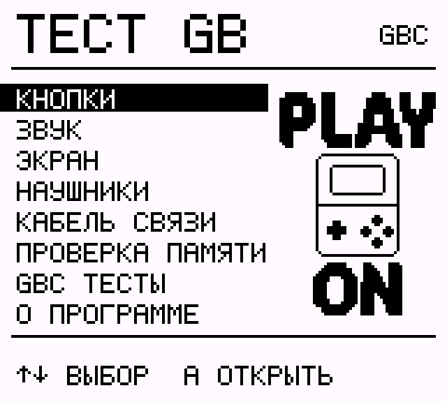

# PLAY ON — Game Boy Color Tester

**Version 1.0.0 · Free diagnostic ROM for Nintendo Game Boy Color**

## What it tests

- **Buttons:** D-pad, A, B, START, SELECT
- **Display:** color fills, 32-level RGB/grayscale gradients, patterns, grid, lines and moving square
- **Sound:** test melody, tones, individual sound channels
- **Headphones:** left and right audio channels
- **Game Link:** link cable communication and error detection
- **Memory:** seven WRAM banks, both VRAM banks and bank switching
- **CPU:** normal and double-speed modes

**[Download Game Boy Color ROM (.gbc)](https://github.com/GrayBearPlayOn/game-boy-color-tester-play-on/releases/download/v1.0.0/play-on-gbc.gbc)** · **[Русская версия](README_RU.md)**

The ROM and source code are **free to download**. If you find this project useful, you can [support PLAY ON on Boosty](https://boosty.to/grayretrobear). Donations are entirely optional.

Source code: [MIT License](LICENSE). Designed for Game Boy Color (CGB mode); not for the original monochrome Game Boy. Physical hardware and Game Link tests have not yet been confirmed.
